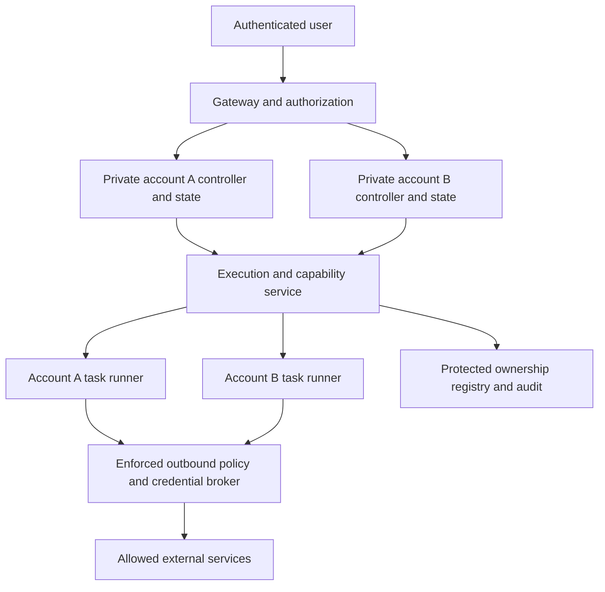

# Fénix user isolation implementation plan

**Implementation update (2026-09-19):** The baseline and file-checkpoint implementation is now available. See [implementation, deployment and verification](execution-isolation.md). This document preserves the original design and acceptance targets; conditional backend research and unexecuted deployment drills are not claimed as completed.

Date: 2026-09-19. **Original design; see the implementation update above.** [Español](../es/user-isolation-plan.md) · [Repository assessment and sources](sandbox-security-review.md) · [Evidence](../research/sandbox-security-2026-09-19.json).

The objective is that one account cannot read, modify, execute against, impersonate, or exhaust another account's resources, including through model-generated code, dependencies, browsers, skills, integrations, background jobs, and restored state. Preserve normal development and browsing workflows by assigning suitable execution profiles instead of granting every task the controller's authority.

## Threat model and invariants

Treat repository files, web pages, model outputs, downloaded tools, package scripts, and external MCP responses as untrusted. Assume a task can execute arbitrary code within its assigned environment. Ordinary users may be mutually hostile. The host operator and narrowly scoped provisioning service are trusted; host compromise is a residual risk requiring patching and operational controls.

The assets are account state, conversation/memory databases, provider and integration credentials, project files, browser cookies, artifacts, schedules, Telegram identity, private skill submissions, execution capacity, and audit records.

Required invariants:

1. Authenticated server state supplies `account_id`. Request headers, filesystem names, model arguments and backend sandbox IDs never establish ownership by themselves.
2. Every resource has a durable owner and lifecycle generation. Authorization covers list, read, write, execute, signal, download, share, connect, resume, clone, and delete—not just creation.
3. A child task, scheduled job or integration inherits an explicit account context and a subset of its permitted capabilities. It cannot broaden authority through delegation.
4. Task execution cannot read controller state or provider keys through files, environment, inherited descriptors, process inspection, browser profiles, or control APIs.
5. A missing execution policy, unavailable identity provider, broken network guard or unsupported isolation capability rejects the operation. There is no automatic fallback to unrestricted host execution.
6. Resource use, including descendants, logs, snapshots and persistent storage, is bounded per task and per account.
7. Sharing is an explicit resource grant; being able to view a conversation or artifact does not grant command execution, credentials, or access to its owner's other resources.
8. Revocation is checked against current trusted state. A restored snapshot or delayed queue message cannot restore revoked access.

## Target architecture

The diagram represents a proposed logical service boundary; it does not require a distributed cluster. The first implementation can remain on one Linux host. The shared execution service must have a small authenticated API and owner-scoped storage, since it becomes a sensitive shared component. Per-account controllers keep conversation state and account-specific configuration; task runners receive only selected project inputs and output locations.

The gateway should mediate artifact and preview access. Do not publicly expose controller ports, browser debugging ports, or arbitrary runner ports. A future preview service uses a separate origin with narrowly scoped, short-lived grants and deliberate cookie/CORS policy, so untrusted application HTML cannot inherit Fénix UI authority.

## Decision: Fénix-owned policy, replaceable execution backend

Implement Fénix's ownership model, policy evaluation, capability grants, lifecycle bookkeeping, and acceptance tests. Reuse maintained isolation primitives. Do not implement a hypervisor, cryptographic scheme, or general enterprise workspace platform from scratch.

| Candidate | Role in the plan | Adoption condition |
|---|---|---|
| Hardened OCI containers | Baseline and migration path | Explicit quotas, verified network rules, non-root identity, no controller mount; shared host kernel remains a limitation |
| gVisor / Kata | Additional candidates, not audited by this seven-repository review | Separate investigation, compatibility tests and supported host setup; do not assume OpenSandbox egress works with every runtime |
| Firecracker-based backend | Preferred candidate to test for a stronger hostile-code boundary | KVM available; maintained guest images and jailer; lifecycle, network and browser/build tests pass |
| OpenSandbox adapter | Optional API/backend integration | Authentication and owner checks explicit; no privilege regression; selected feature set demonstrated |
| E2B / Daytona managed adapter | Optional operational alternative | Versioned contract, data handling/cost review, tenant mapping, ingress restrictions and feature probes |
| CubeSandbox | Research candidate and design reference | Independent hardening of internal/control APIs, callbacks, ingress, policy precedence and operations |
| Sandboxie | Future Windows-specific research | A Windows requirement actually exists; not a dependency for current Linux work |

Choose the execution engine after measuring representative Fénix tasks. Do not claim that microVMs alone solve authorization or that installing multiple sandbox platforms adds their guarantees together.

## Phase 0 — ownership contract and verification fixtures

**Priority P0; dependency for every subsequent phase.** Inventory current routes and tool dispatch paths: gateway, runtime API, projects, process handles, files/artifacts, SSE, skill marketplace, browser/CDP, schedules, subagents and integration credentials. Record which component establishes identity and where it is checked again.

Create an Alice/Bob test fixture with separate synthetic secrets, projects, artifacts, private submissions and jobs. Use fake providers and local test endpoints. Keep explicitly public marketplace content distinguishable from private owner resources. Add negative tests before changing boundaries, so migration cannot silently weaken existing checks.

Relevant code: `apps/server/src/accounts.rs`, `accounts/sessions.rs`, `skill_guard/`, `crates/fenix-agent/src/permissions.rs`, `projects.rs`, `processes.rs`, `telegram.rs`, and storage tests. New shared execution code must use typed account/task identifiers internally, not interchangeable strings supplied by callers.

**Exit:** an authorization matrix covers every operation; existing seven account tests pass; cross-account fixtures fail closed with no existence leak where practical. This is a coverage deliverable, not proof against kernel escapes.

## Phase 1 — make current deployment guarantees explicit

**Priority P0.** Improve `scripts/tenant-container.py`, `scripts/tenant-network-guard.py`, `packaging/linux/fenix-user@.service`, and deployment checks.

- Replace security-critical Python `assert` validation with unconditional validation. Reject invalid/duplicate account mappings and unexpected upstreams. Reject UID 0 for tenant execution; select a deliberate identity strategy rather than copying the invoking user's UID. Evaluate unique host UIDs or user-namespace mappings, accounting for persistent-file ownership during migration.
- Construct and validate the complete intended firewall policy, not just chain existence. Use a transactional rule update where supported; do not flush unrelated host rules. Test partial installation, stale rules, restart, concurrent provisioning and failure during update. Gate workload start on verified policy, and monitor/reconcile drift. A failed update must leave the previous safe policy or stop affected workloads.
- Bound memory/swap, CPU, kernel PIDs, open files, output/log volume and execution concurrency. Implement persistent storage quotas through a supported backing filesystem/storage mechanism; a bind mount or tmpfs size is not a quota for the account directory. Reserve capacity for gateway and host operations, and enforce admission before launch.
- Keep Docker automatic restart disabled unless an equivalent pre-start enforcement mechanism exists. Document one supported startup route and remove the contradictory manual-start suggestion from provisioning output when implementing the change.
- Pin production image digests and record runtime/kernel versions. Add image/dependency update ownership and emergency patch procedures. Verify missing Docker/seccomp/cgroup/network support causes a visible rejection.

**Exit:** a disposable-host deployment suite demonstrates limits and isolation, including an existing empty firewall chain, a root invocation, a interrupted update, a reboot, and bounded hostile child processes. No claim of deployed correctness from a mock alone.

## Phase 2 — separate controller state from task execution

**Priority P1; depends on phases 0–1.** Introduce a backend-neutral runner interface such as `create`, `exec`, `status`, `cancel`, `upload`, `download`, and `destroy`. Add `pause`, `resume`, and `snapshot` only when ownership and revocation semantics are tested.

Suggested new component: `crates/fenix-execution/` (proposed, not currently created). Route shell/PTY, package installers, tests/builds, configured language servers, skill helper scripts and browser processes through it. Review `crates/fenix-agent/src/processes.rs`, `coding/lsp.rs`, `project_tools.rs`, `files.rs`, `crates/fenix-browser/`, and `apps/server/src/browser.rs`. Avoid an unreviewed secondary execution path.

The controller generates a grant containing account, project/task, runner ID, lifecycle generation, permitted operations, policy version, resource budget and deadline. The runner registry—not a caller-supplied path—resolves the actual workspace and backend resource. Authenticate service transport; use established token libraries or opaque server-stored capabilities. Expiry alone does not replace revocation.

Runner mounts contain only selected inputs and writable project/output areas. Exclude account database, provider settings, credential storage, session registry, unrelated projects, browser profiles and controller process namespaces. Create subprocess environments from an allowlist, close inherited descriptors, and apply one policy across shell, PTY, LSP and helper tools. Preserve the existing Landlock/seccomp read-only path and its fail-closed behavior.

Use per-task worktrees or equivalent isolated changesets where parallel tasks edit a project; merge/review output with owner authorization. Enforce filesystem operations relative to trusted directory handles and reject escape through symlinks, archive extraction, hard links or mount changes. Canonicalization alone is not a complete race defense.

**Exit:** synthetic account credentials remain unreadable from every runner execution path while legitimate builds, file edits, output downloads and cancellation work. Killing a task removes its entire cgroup/VM and descendants, including detached children, without touching the other account.

## Phase 3 — credential brokerage and network policy

**Priority P1; overlaps phase 2 design.** Keep provider/integration credentials in trusted account services or an external secret store. Runners receive handles or limited tokens, never the controller's master credentials. Prefer explicit authenticated service calls; use transparent HTTPS interception only if compatibility requires it and its certificate/trust implications are deliberately supported.

Broker grants bind account, task generation, service, destination, port, method, path and usage limits. Validate redirect behavior, normalized URLs, header collisions, response reflection and payload-level authorization. Do not let a model replace `account_id`, integration connection ID or a Composio-style external account identifier. Per-user OAuth must remain per-user through refresh, background execution and disconnect. Shared service credentials require explicit narrower permissions.

Hiding a token does not prevent misuse of an allowed API. The broker must authorize the operation and resource, limit spending, and preserve the user's existing authorization rules for external writes. Secret redaction is secondary protection, not a substitute for removing access.

Provide operator-defined profiles:

| Profile | Intended work | Exposure |
|---|---|---|
| Offline inspection | Analyze supplied files/repositories | Explicit inputs, no external network, no credentials |
| Development | Build/test and fetch dependencies | Project-only writes; permitted registries/proxy; task quotas |
| Web research | Browse public information | Public web through guarded egress; no unrelated account data |
| Authorized integration | Specific external operation | Broker-authorized service/resource and bounded credential scope |

Platform denies for other tenants, control services, metadata endpoints and host addresses cannot be overridden by task-requested allowances. Cover IPv4 and IPv6 or reject unsupported address families; validate DNS answers/rebinding, direct IP, alternate DNS, UDP/QUIC, redirects and host public-IP hairpin paths. A DNS filter or proxy environment variable alone is not enforcement. Removing or changing a policy must account for existing connections, not only new ones.

**Exit:** network and credential test cases pass; broker outage/revocation cannot produce a direct unrestricted retry; allowed browsing and dependency downloads remain functional.

## Phase 4 — browser, live revocation and controlled sharing

**Priority P1.** Replace the current tenant Chromium `--no-sandbox` arrangement with a tested browser runner design that preserves a suitable inner sandbox or a separately justified strong boundary. Do not solve startup by granting privileged mode or broad `SYS_ADMIN` to the account container.

Separate browser profiles by account and purpose. Authenticated browsing receives an explicit selected profile; ordinary research must not inherit unrelated cookies. Protect CDP, downloads, clipboard, screenshots and navigation to internal services with the same ownership and network rules as other tools.

Add deliberate live account/session revocation through trusted registry reload or a revocation store; coordinate active streams, queued jobs and process capabilities. Keep the existing fixed 168-hour browser-session policy unless product requirements change. Define whether user logout ends only that browser session or also selected jobs; account disablement must stop all relevant capabilities. A paused or quiet SSE stream must not remain a loophole after invalidation.

Sharing grants name the resource, recipient, actions and expiry/revocation. Default remains private. The marketplace's approved public snapshots stay explicitly public; private originals and reports remain owner-scoped. Future chat sharing must define attachments and subtask inheritance without granting execution.

**Exit:** Alice cannot access Bob's artifacts, profile, process handles, private skill content, previews or streams using copied IDs/URLs. Explicitly permitted sharing works and revokes without broadening access.

## Phase 5 — stronger isolation, snapshots and operations

**Priority P2 for backend selection and optimizations; never defer the preceding baseline.** Prototype one stronger runtime using representative coding/browser tasks. Measure end-to-end cold/warm latency, p50/p95, total host/guest memory, disk/IO, concurrent-account fairness and cleanup reliability. Include provisioning, networking and app startup, not just hypervisor launch time. State supported hardware and fallback policy explicitly.

Only then enable warm pools or snapshots. A clean template contains no account data or credentials. Bind snapshot/volume/artifact metadata to account, generation, image digest and policy version; encrypt and authenticate stored state with keys outside the runner. Enforce separate retention, deletion and quotas. On restore, reauthorize against current state, issue fresh execution/preview credentials, handle entropy correctly and discard stale network sessions. Never reuse one user's live image for another account. External API side effects are not undone by local rollback; retry logic needs idempotency and reconciliation.

Emit structured audit events outside runner-writable storage: actor/account, task, runner/generation, resource, action, decision, policy revision, timestamps and outcome. Exclude secrets, cookies and unnecessary request bodies. Limit retention/storage; protect log access; distinguish operator changes from user actions. Monitor denied cross-owner attempts, policy drift, orphaned processes, quota pressure and broker failures. Maintain an incident procedure for stopping an account, revoking tokens, preserving limited evidence and recovering from clean images.

**Exit:** the selected backend passes the same owner/security contract as the baseline; restore cannot revive revoked access; operational drills show recovery without data crossing owners.

## Acceptance matrix

The matrix below preserves the original acceptance targets. Current evidence and untested cases are recorded in [implementation validation](../research/execution-isolation-validation-2026-09-19.json); this table does not claim every scenario has passed. Use disposable infrastructure and synthetic data for adversarial tests.

| ID | Scenario | Required result |
|---|---|---|
| A01 | Alice supplies Bob's ID in path/body/header | Authenticated owner remains Alice; Bob's resource denied |
| A02 | List/search/paginate private objects | No Bob-owned rows, counts, attachments or private reports |
| A03 | Reorder registry; restart gateway | Sessions retain stable account identity and original expiry |
| A04 | Disable account/change password; quiet SSE/reconnect | Documented live revocation applies; no stale reconnect |
| A05 | Guess/copy process, task, runner and artifact IDs | Read/signal/download/delete denied across accounts |
| A06 | Subagent, schedule or Telegram event | Correct durable owner and bounded inherited authority |
| A07 | MCP/OAuth refresh with foreign integration ID | Rejected before external request or credential resolution |
| A08 | Private skill report/original versus approved public snapshot | Private content denied; intentional public content usable |
| F01 | Shell, PTY, LSP and package script read controller DB/environment/proc | Synthetic secrets unavailable in every path |
| F02 | Symlink swap, traversal, archive escape, hard-link attempt | Access stays within granted directory handles/mounts |
| F03 | Concurrent Alice/Bob project writes | No cross-account changes; same-project conflicts explicit |
| N01 | Private IP, metadata, host IP, tenant port and public-IP hairpin | Denied except narrow platform-defined service routes |
| N02 | IPv6, direct IP, alternate DNS, DNS rebinding, redirects | No bypass of effective destination policy |
| N03 | TCP/UDP/QUIC and non-proxy-aware client | Packet-level boundary holds |
| N04 | Existing empty/stale chain; interrupted rule update | Repaired and verified or workload denied startup |
| N05 | Host reboot, Docker restart, firewall drift | No unguarded execution interval accepted by the service |
| N06 | Policy/broker unavailable or incompatible backend | Explicit failure; no unrestricted fallback |
| C01 | Credential host/SNI/port/method/path mismatch | No credential injection; operation denied as policy requires |
| C02 | Revoked grant, delayed job and restored snapshot | Old authority cannot be reused |
| C03 | Echo endpoint, redirects and logs | No raw secret exposed to workload or ordinary audit readers |
| C04 | Allowed API used on unauthorized resource/spending scope | Broker rejects despite valid destination |
| R01 | Root provisioning and invalid/duplicate registry mappings | Reject or deliberately map to validated non-root identity |
| R02 | Bounded CPU, RAM, process and descriptor pressure | Account limits enforced; other account remains responsive |
| R03 | Disk, logs, artifact and snapshot growth | Storage limits enforced without filling host/control storage |
| R04 | Cancel/crash with detached children | Whole execution domain removed; no orphan service |
| B01 | Browser internal navigation, CDP/profile access | Network and account boundaries enforced |
| B02 | Untrusted preview HTML | No Fénix UI cookies or controller-origin privileges |
| B03 | Reused expired/revoked preview URL or another port | Rejected; grant applies only to intended service |
| S01 | Snapshot restore after owner disablement | Current authorization wins over saved state |
| S02 | Warm pool reassignment and clone | No previous-owner files, secrets, cookies or live credentials |
| S03 | Local rollback after external write | No accidental repeated side effect |
| O01 | Runner modifies/deletes audit evidence | Protected audit survives; access itself audited |
| O02 | Normal build, browser, integrations and file downloads | Supported workflows succeed within declared profiles |

## Migration and review sequence

1. Land ownership fixtures and provisioning hardening as separate reviewable changes. Exercise deployment checks on a disposable host; report actual runtime/kernel versions.
2. Add the runner interface with one backend behind a capability/configuration gate. Migrate one execution path at a time, but mark the account as fully separated only when every path is covered.
3. Migrate credentials out of runner-visible storage. Back up state, verify migration with synthetic fixtures, rotate exposed long-lived values where appropriate, and avoid copying credentials into images or snapshots.
4. Canary synthetic accounts, then selected real accounts under the operator's normal rollout process. Preserve account UUIDs, conversation history, projects, fixed session duration and single Telegram polling ownership. Reconcile scheduled work before switching runtime ownership.
5. Enable stronger isolation and lifecycle optimizations only after the common acceptance suite passes. Publish supported profiles and remaining limitations in EN/ES deployment documentation.

Rollback restores a known version/configuration and compatible state without weakening the promised boundary. An unavailable secure backend should leave execution unavailable, not fall back to host shell. Do not dual-run jobs that can send messages, modify external services or duplicate Telegram polling.

The first concrete implementation should be **Phase 0 plus Phase 1**. Host capabilities, workload concurrency, integration needs and storage support can be measured during that work. They do not justify delaying the already identified ownership, UID, firewall and quota improvements.
