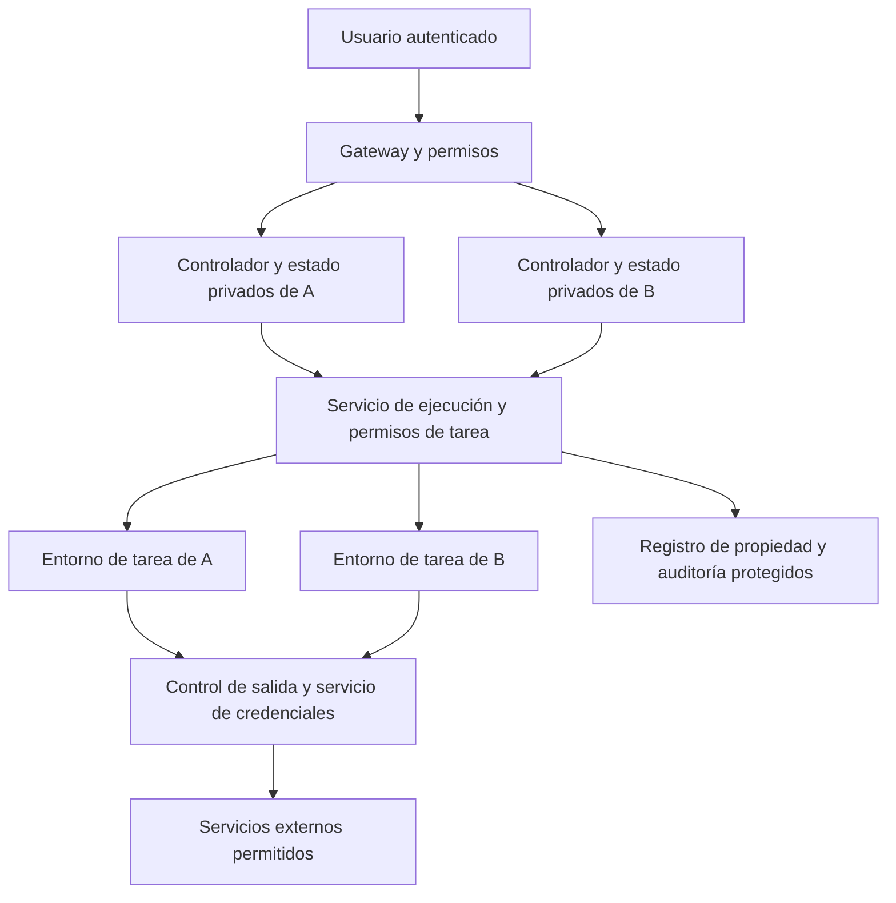

# Plan para reforzar el aislamiento de usuarios de Fénix

**Actualización de implementación (2026-09-19):** Ya están implementados el aislamiento base y las copias cifradas de archivos. Consulta [implementación, despliegue y verificación](execution-isolation.md). Este documento conserva el diseño y las pruebas objetivo originales; no se presentan como terminadas las investigaciones condicionadas ni los simulacros de despliegue no ejecutados.

Fecha: 19 de septiembre de 2026. **Diseño original; consultar la actualización de implementación anterior.** [English](../en/user-isolation-plan.md) · [Análisis de repositorios](sandbox-security-review.md) · [Evidencias](../research/sandbox-security-2026-09-19.json).

El objetivo es que una cuenta no pueda leer, modificar, ejecutar acciones sobre, suplantar o agotar los recursos de otra. Esto incluye código generado, dependencias, navegadores, skills, integraciones, tareas programadas y estado restaurado. Los flujos normales de desarrollo y navegación deben funcionar con permisos adecuados a cada tarea.

## Modelo de amenazas y reglas

Consideramos no confiables los repositorios, páginas web, respuestas de herramientas externas, dependencias y código generado. Una tarea puede ejecutar código arbitrario dentro de su entorno; dos usuarios pueden ser adversarios. El operador del host y el servicio mínimo de aprovisionamiento son confiables. La protección del host requiere mantenimiento aparte.

Hay que proteger conversaciones, memoria, proyectos, credenciales, cookies, artefactos, tareas, identidad de Telegram, publicaciones privadas de skills, capacidad de ejecución y auditoría.

1. El servidor autenticado determina `account_id`; ni el modelo ni una cabecera, ruta o ID de sandbox proporcionado por el cliente establecen propiedad.
2. Cada recurso tiene propietario y generación de ciclo de vida. Comprobar permisos al listar, leer, escribir, ejecutar, cancelar, descargar, compartir, conectar, reanudar, clonar y borrar.
3. Subagentes, tareas programadas e integraciones heredan una cuenta y permisos acotados; la delegación no amplía autoridad.
4. La ejecución no puede leer estado ni secretos del controlador por archivos, entorno, descriptores heredados, procesos, navegador o API interna.
5. Si faltan permisos, controles de red o capacidades de aislamiento, rechazar la operación. No recurrir automáticamente a una shell sin restricciones del host.
6. Limitar recursos por tarea y cuenta, incluidos descendientes, registros, snapshots y almacenamiento persistente.
7. Compartir un recurso no concede ejecución ni acceso a otros recursos del propietario.
8. La revocación actual prevalece sobre snapshots antiguos y mensajes de colas pendientes.

## Arquitectura propuesta

Puede comenzar en un único host Linux. No requiere Kubernetes ni una plataforma distribuida. El servicio compartido de ejecución será sensible: API pequeña, autenticada y con propiedad explícita. Cada controlador conserva la memoria y configuración de su cuenta; cada runner recibe únicamente los proyectos y salidas necesarios.

El gateway controla descargas y previews. Los puertos del controlador, depuración del navegador y otros servicios internos no se publican directamente. Las aplicaciones no confiables deben mostrarse desde otro origen, con permisos temporales y cookies/CORS delimitados, para que su HTML no herede autoridad de la interfaz de Fénix.

## Qué será propio y qué reutilizaremos

Nuestra implementación debe definir identidad, propiedad, políticas, permisos de tarea, ciclo de vida y pruebas. Conviene reutilizar motores de aislamiento y bibliotecas criptográficas mantenidas.

| Opción | Uso propuesto | Condición |
|---|---|---|
| Contenedores OCI reforzados | Base y camino de migración | Cuotas, identidad no-root, red verificada y separación del controlador; siguen compartiendo kernel |
| gVisor / Kata | Candidatos adicionales | Investigación propia pendiente; compatibilidad demostrada, especialmente con controles de red |
| Backend basado en Firecracker | Candidato para código hostil | KVM disponible, imágenes mantenidas y pruebas de ciclo de vida/navegador/compilación |
| OpenSandbox | Adaptador opcional | Autenticación y propiedad verificadas, sin regresión de privilegios |
| E2B / Daytona gestionados | Alternativa operativa opcional | Contrato fijado, tratamiento de datos/costos evaluado, mapeo de cuentas y funciones probado |
| CubeSandbox | Referencia y candidato de investigación | Endurecer API, servicios internos, ingreso y precedencia de red |
| Sandboxie | Investigación futura Windows | Necesidad real de Windows; no depende de él la mejora Linux |

La selección final del motor depende de mediciones con tareas reales de Fénix. Una microVM no sustituye la autorización por usuario; combinar varias plataformas no suma automáticamente sus garantías.

## Fase 0: contrato de propiedad y pruebas

**P0; requisito para las demás fases.** Inventariar rutas y caminos de ejecución: gateway, API del runtime, proyectos, archivos, procesos, artefactos, SSE, mercado de skills, navegador/CDP, tareas, Telegram e integraciones. Documentar quién establece identidad y dónde se vuelve a comprobar.

Crear usuarios ficticios Alice/Bob con proyectos, secretos sintéticos, artefactos, publicaciones privadas y tareas diferentes. Usar proveedores falsos y servicios locales de prueba. Diferenciar contenido intencionalmente público del mercado de sus originales e informes privados.

Archivos principales: `apps/server/src/accounts.rs`, `accounts/sessions.rs`, `skill_guard/`, `crates/fenix-agent/src/permissions.rs`, `projects.rs`, `processes.rs`, `telegram.rs` y pruebas de almacenamiento. El código compartido nuevo debe distinguir tipos de ID de cuenta, tarea y recurso.

**Aceptación:** matriz de autorización por operación, las siete pruebas actuales aprobadas y pruebas negativas de acceso cruzado. No presentar esto como una prueba de ausencia de escapes de kernel.

## Fase 1: garantías explícitas del despliegue actual

**P0.** Trabajar sobre `scripts/tenant-container.py`, `scripts/tenant-network-guard.py`, `packaging/linux/fenix-user@.service` y sus verificaciones.

- Sustituir `assert` en validaciones de seguridad por validación incondicional. Rechazar mapeos inválidos/duplicados y upstreams inesperados. Impedir ejecución de tenants como UID 0. Elegir identidades no privilegiadas deliberadas y evaluar UID distinto o user namespaces por cuenta, considerando permisos de archivos existentes.
- Instalar y comprobar la política completa de firewall; no basta la existencia de una cadena. Actualizar de forma transaccional cuando sea posible, sin borrar reglas ajenas. Probar instalación parcial, reglas viejas, concurrencia, reinicio y fallo durante actualización. Si no hay política segura verificada, no iniciar el trabajo. Supervisar y corregir cambios posteriores.
- Limitar CPU, memoria/swap, PID, descriptores, concurrencia y volumen de registros. Aplicar cuotas reales de almacenamiento persistente mediante un mecanismo soportado. El tamaño de tmpfs no limita el directorio de la cuenta. Reservar recursos para gateway y host.
- Mantener un arranque único que aplique controles antes de ejecutar. Corregir la sugerencia actual de inicio manual cuando se implemente esta fase. No permitir reinicios Docker que salten el control previo.
- Fijar imágenes por digest, registrar versiones de runtime/kernel y definir mantenimiento de dependencias. Rechazar capacidades de seguridad faltantes en lugar de degradar silenciosamente.

**Aceptación:** suite en un host desechable con cadena vacía preexistente, invocación root, actualización interrumpida, reinicio y procesos hijos limitados. Las simulaciones ya realizadas no reemplazan estas pruebas de despliegue.

## Fase 2: separar controlador y ejecución

**P1; depende de 0–1.** Introducir interfaz `create`, `exec`, `status`, `cancel`, `upload`, `download`, `destroy`. Pausa, reanudación y snapshots se habilitarán después de probar propiedad y revocación.

Componente sugerido: `crates/fenix-execution/`, todavía no creado. Pasarán por él shell, PTY, instaladores, compilaciones, tests, servidores de lenguaje, scripts de skills y procesos de navegador. Revisar `processes.rs`, `coding/lsp.rs`, `project_tools.rs`, `files.rs`, `crates/fenix-browser/` y `apps/server/src/browser.rs` para evitar rutas secundarias sin protección.

El controlador emite un permiso que vincula cuenta, proyecto/tarea, runner, generación, operaciones, versión de política, presupuesto y plazo. Un registro confiable resuelve rutas y recursos reales; el cliente no elige arbitrariamente el sandbox. Autenticar el transporte y usar tokens establecidos o permisos opacos almacenados en el servidor, con revocación además de caducidad.

Montar solo entradas seleccionadas y áreas de proyecto/salida. Excluir base de datos, claves, configuración privada, registro de sesiones, otros proyectos y perfiles de navegador. Crear el entorno de cada proceso desde una lista permitida y cerrar descriptores heredados. Aplicar la misma regla a shell, PTY, LSP y scripts. Conservar Landlock/seccomp del modo de lectura.

Para tareas simultáneas, usar worktrees o cambios aislados y aplicar resultados con permisos del propietario. Acceder a archivos desde descriptores de directorio confiables, contemplando carreras con enlaces, extracción de archivos y cambios de montaje.

**Aceptación:** ninguna ruta de ejecución lee secretos sintéticos del controlador; compilaciones, edición, descarga y cancelación siguen funcionando. La cancelación elimina el dominio completo de procesos, incluidos hijos desacoplados, sin afectar otra cuenta.

## Fase 3: credenciales y salida de red

**P1; diseñar junto con fase 2.** Mantener secretos en servicios confiables de cuenta o un almacén externo. El runner recibe referencias o tokens limitados. Preferir llamadas autenticadas explícitas; introducir interceptación HTTPS únicamente si se necesita y se resuelve su confianza/certificados.

El permiso debe limitar cuenta, generación de tarea, servicio, destino, puerto, método, ruta y consumo. Comprobar redirecciones, normalización, cabeceras, respuestas que reflejen secretos y autorización del recurso de negocio. No aceptar del modelo un identificador de cuenta/integración externa como prueba de propiedad, incluidas integraciones del estilo Composio. OAuth, refresco y desconexión deben conservar identidad individual.

Ocultar el token no evita abusar de una API permitida: hay que controlar operación, recursos y gasto. Preservar la autorización del usuario para escrituras externas. La redacción de registros es secundaria frente a impedir que la tarea obtenga el secreto.

| Perfil | Trabajo | Permisos |
|---|---|---|
| Inspección sin red | Analizar archivos y código entregados | Entradas explícitas, sin secretos ni red externa |
| Desarrollo | Compilar, probar, descargar dependencias | Escritura en proyecto, registros/proxy permitidos, cuotas |
| Investigación web | Navegar información pública | Salida pública protegida, sin datos ajenos a la tarea |
| Integración autorizada | Operación externa concreta | Servicio/recurso autorizado mediante broker |

Las prohibiciones de plataforma sobre otros tenants, control, metadatos y host prevalecen sobre solicitudes de tareas. Cubrir IPv4/IPv6 o rechazar la familia no soportada; probar DNS rebinding, IP directa, DNS alternativo, UDP/QUIC, redirecciones y acceso al host por su IP pública. También considerar conexiones ya establecidas al revocar políticas. Una variable de proxy o filtro DNS no basta.

**Aceptación:** fallos o revocaciones del broker no generan un reintento directo sin restricciones; navegación y descargas autorizadas funcionan.

## Fase 4: navegador, revocación y compartición

**P1.** Sustituir el Chromium con `--no-sandbox` por un runner de navegador probado que conserve aislamiento interno adecuado o una frontera fuerte justificada. No arreglar incompatibilidades concediendo modo privilegiado o `SYS_ADMIN` al contenedor de cuenta.

Separar perfiles por cuenta y finalidad; la investigación normal no hereda cookies privadas. Proteger CDP, capturas, portapapeles, descargas y navegación interna con las mismas reglas de identidad/red.

Añadir revocación en vivo mediante recarga controlada o registro de revocaciones; incluir streams, colas y permisos de proceso. Conservar la duración fija actual de 168 horas salvo cambio de producto. Definir si logout afecta solo la sesión web o tareas seleccionadas; deshabilitar una cuenta invalida todas sus capacidades pertinentes.

Compartir requiere recurso, destinatario, operaciones y revocación. Mantener privados los originales e informes de skills y públicos solo los snapshots aprobados previstos. Si se comparten conversaciones, definir herencia a adjuntos/subtareas sin conceder ejecución.

**Aceptación:** copiar IDs o URLs de otra cuenta no permite leer archivos, streams, procesos, perfiles, previews o contenido privado. La compartición autorizada funciona y se revoca.

## Fase 5: aislamiento más fuerte, snapshots y operación

**P2 para elegir motor y optimizar; no posponer la base anterior.** Probar un runtime más fuerte con compilaciones y navegador. Medir latencia fría/caliente p50/p95, memoria total host/invitado, disco/IO, concurrencia y limpieza. Incluir aprovisionamiento y arranque de aplicaciones, no solo el inicio de la VM.

Habilitar pools/snapshots después. Plantillas limpias, sin secretos ni datos de usuarios; propiedad y generación en metadatos de snapshots/volúmenes/artefactos; cifrado e integridad con claves fuera del runner; cuotas y retención separadas. Al restaurar, comprobar permisos actuales, emitir credenciales nuevas y tratar entropía/conexiones antiguas. No reasignar una imagen viva de un usuario a otro. Las operaciones externas no se deshacen con rollback: se necesitan idempotencia y reconciliación.

Guardar auditoría fuera del espacio escribible por el trabajo: actor/cuenta, tarea, runner/generación, recurso, acción, decisión, política, tiempos y resultado. Excluir secretos/cookies y cuerpos innecesarios; limitar almacenamiento y acceso. Supervisar accesos cruzados rechazados, cambios de red, huérfanos y cuotas. Documentar contención de cuenta, revocación, conservación mínima de evidencia y recuperación limpia.

**Aceptación:** el backend cumple el contrato común, restaurar no revive permisos revocados y la recuperación no mezcla datos entre propietarios.

## Matriz de aceptación

La matriz conserva los objetivos originales de aceptación. La [validación de la implementación](../research/execution-isolation-validation-2026-09-19.json) identifica la evidencia actual y los casos pendientes; esta tabla no afirma que todos hayan pasado. Usar infraestructura desechable y datos ficticios.

| ID | Escenario | Resultado requerido |
|---|---|---|
| A01 | Alice envía ID de Bob en ruta/cuerpo/cabecera | El propietario autenticado no cambia; acceso rechazado |
| A02 | Listar/buscar/paginar recursos privados | Sin filas, adjuntos, informes o conteos de Bob |
| A03 | Reordenar registro y reiniciar | Identidad estable y caducidad original |
| A04 | Deshabilitar cuenta/cambiar contraseña, SSE silencioso | Revocación definida también al reconectar |
| A05 | Copiar ID de proceso/tarea/runner/artefacto | Sin lectura, señal, descarga o borrado ajenos |
| A06 | Subagente, tarea programada, Telegram | Propietario persistente y permisos acotados |
| A07 | Refrescar OAuth/MCP con conexión ajena | Rechazo antes de resolver secreto o hacer petición |
| A08 | Original privado frente a snapshot público de skill | Privacidad correcta y publicación intencional operativa |
| F01 | Shell/PTY/LSP/instalador lee DB, entorno o procesos | Secretos del controlador inaccesibles |
| F02 | Carrera de enlaces, traversal, extracción, hard links | Acceso dentro de rutas/montajes concedidos |
| F03 | Escrituras simultáneas | Sin cambios entre cuentas; conflictos explícitos |
| N01 | Red privada, metadatos, host, otro tenant, IP pública del host | Bloqueo salvo rutas de plataforma concretas |
| N02 | IPv6, IP directa, DNS alternativo/rebinding, redirects | Sin elusión de política de destino |
| N03 | TCP/UDP/QUIC y cliente que ignora proxy | Aislamiento de paquetes efectivo |
| N04 | Cadena vacía/vieja o actualización interrumpida | Reparación verificada o arranque rechazado |
| N05 | Reinicio/alteración de firewall | Sin ejecución aceptada sin protección |
| N06 | Broker/política ausente o backend incompatible | Fallo explícito sin fallback inseguro |
| C01 | Host/SNI/puerto/método/ruta fuera del permiso | Sin inyección de credenciales |
| C02 | Permiso revocado, tarea tardía y snapshot | Autoridad antigua inutilizable |
| C03 | Endpoint de eco, redirects y registros | Sin secreto real expuesto |
| C04 | API permitida, recurso o gasto no autorizado | Rechazo del broker |
| R01 | Aprovisionamiento root/mapeo inválido o duplicado | Rechazo o identidad deliberada no-root validada |
| R02 | Presión acotada de CPU/RAM/PID/descriptores | Límites efectivos; otra cuenta operativa |
| R03 | Crecimiento de disco/registros/artefactos/snapshots | Cuotas sin llenar host o almacenamiento de control |
| R04 | Cancelación/fallo con hijos desacoplados | Eliminación completa, sin huérfanos |
| B01 | Navegador a red interna/CDP/perfiles | Fronteras de red y cuenta respetadas |
| B02 | HTML no confiable en preview | Sin cookies o autoridad del origen Fénix |
| B03 | Preview caducado/revocado o de otro puerto | Rechazo |
| S01 | Restaurar tras deshabilitar propietario | Prevalece autorización actual |
| S02 | Reasignación de pool y clonación | Sin datos, cookies o credenciales del usuario anterior |
| S03 | Rollback después de escritura externa | Sin repetición accidental del efecto |
| O01 | Runner modifica auditoría | Evidencia protegida y acceso registrado |
| O02 | Desarrollo, navegador, integraciones y descargas normales | Flujos soportados funcionan con sus perfiles |

## Migración y orden de trabajo

1. Cambios revisables separados para pruebas de propiedad y endurecimiento del aprovisionamiento. Verificar en host desechable y registrar versiones reales.
2. Introducir interfaz de ejecución y un backend mediante configuración explícita. Migrar cada camino; no anunciar separación completa mientras quede alguno sin cubrir.
3. Sacar credenciales del almacenamiento visible por runners. Respaldar, validar migración y rotar valores expuestos cuando corresponda. No guardarlos en imágenes/snapshots.
4. Comenzar con cuentas ficticias y luego cuentas seleccionadas mediante el proceso normal de despliegue. Preservar UUID, historial, proyectos, duración de sesión y un solo propietario del polling de Telegram. Reconciliar trabajos pendientes.
5. Habilitar aislamiento más fuerte y optimizaciones tras aprobar la matriz. Documentar perfiles soportados y límites en español e inglés.

El rollback conserva una versión/configuración segura y estado compatible. Si falla el backend seguro, la ejecución queda indisponible; no vuelve a una shell del host. Evitar doble ejecución de trabajos que envían mensajes o modifican servicios externos.

**Primer trabajo recomendado: fases 0 y 1.** Después, separar ejecución y credenciales. Las mediciones del host, concurrencia y almacenamiento sirven para elegir el motor y los límites concretos; no impiden corregir las carencias de propiedad, UID, firewall y cuotas ya identificadas.
